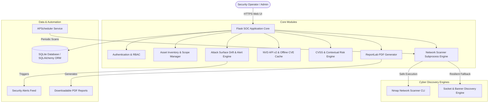

# Real-Time Attack Surface Monitoring and Vulnerability Intelligence System

[](https://www.python.org/)
[](https://flask.palletsprojects.com/)
[](LICENSE)
[-brightgreen.svg)]()
[]()

A centralized, enterprise-grade cybersecurity web application and Security Operations Center (SOC) dashboard. The platform empowers security teams, network administrators, and researchers to discover perimeter assets, detect open ports and running services using **Nmap**, correlate discovered software versions with live **NIST National Vulnerability Database (NVD)** CVE intelligence, compute contextual risk scores, track attack surface drift in real-time, and generate executive-ready PDF audit reports.

---

## Architecture Overview



---

## Key Features

### 1. User Authentication & Administrative Audit Trail
- Secure administrator registration and login with password hashing.
- Role-based session management (`Flask-Login`) with auto-timeout.
- Comprehensive security audit log recording every login attempt, asset modification, scan launch, and PDF export.

### 2. Digital Asset Inventory & Scope Management
- Manage authorized IP addresses (IPv4/IPv6), domain names, and CIDR subnets (up to `/22`).
- Mandatory legal authorization verification checkbox before saving targets.
- Asset tagging: Environment (`Production`, `Staging`, `Internal`, `DMZ`) and Criticality (`Critical`, `High`, `Medium`, `Low`).
- One-click continuous monitoring toggle.

### 3. Multi-Engine Network Scanner
- Native integration with **Nmap** using safe subprocess parameterization (no `shell=True` to prevent arbitrary command injection).
- Safe scan profiles:
  - **Standard Service Scan** (`-sV -T4 --top-ports 100`): Balanced discovery and service detection.
  - **Quick Discovery** (`-T4 -F`): Rapid host ping and fast ports.
  - **Deep Vulnerability Scan** (`-sV -sC -p 1-1000`): In-depth service banners and scripts.
- **Native Python Socket & Cyber Lab Emulation Fallback**: Automatically activates if Nmap is absent in restricted environments, ensuring immediate out-of-the-box operation and continuous demo capability.
- Real-time terminal output stream in the web UI with duration tracking.

### 4. CVE Vulnerability Intelligence & NVD API v2
- Live query integration with the official **NIST National Vulnerability Database (NVD) API v2**.
- Embedded offline high-fidelity CVE database for instant offline analysis and rate-limit resilience.
- Extracts CVSS v3.1 base scores, CVSS vector strings, CWE classifications, and published dates.
- Assigns detection confidence levels (`High`, `Medium`, `Low`) based on software release version matches.

### 5. Contextual Risk Assessment Engine
- Computes an infrastructure risk score (0.0 to 10.0) combining:
  $$\text{Composite Risk} = 0.40 \times \text{CVSS} + 0.30 \times \text{Asset Criticality} + 0.20 \times \text{Port Exposure} + 0.10 \times \text{Confidence}$$
- Flags sensitive listening ports (FTP 21, SSH 22, Telnet 23, SMB 445, RDP 3389, MySQL 3306, Redis 6379, etc.).
- Full vulnerability lifecycle tracking: `Open`, `In Progress`, `Resolved`, and `False Positive` with analyst mitigation notes.

### 6. Real-Time Monitoring & Attack Surface Drift Detection
- Differential scan comparator detecting changes between consecutive scans:
  - **New Open Ports** (`Critical`/`High` alert).
  - **Closed Ports** (`Low` alert).
  - **Software Version Upgrades/Downgrades** (`Medium` alert).
- Background recurring scan scheduler powered by **APScheduler** (hourly, daily, weekly).

### 7. Modern Dark Cyber SOC Dashboard
- Operations center dark theme with responsive sidebar and glow accents.
- 6 Key Performance Indicator (KPI) cards: Monitored Assets, Exposed Ports, Detected CVEs, Critical Count, High Count, Risk Posture Index.
- 4 Interactive **Chart.js** visualizations:
  1. Vulnerability Severity Breakdown (Doughnut).
  2. Top Exposed Network Ports (Bar).
  3. Historical Attack Surface Exposure Trend (Multi-line).
  4. Asset Risk Index Distribution (Bar).
- Live unread notification counter badge in sidebar.

### 8. Automated PDF Security Assessment Reports
- Generates executive-ready PDF audit reports using **ReportLab**.
- Formatted cover banner, executive summary KPI block, full asset inventory table, discovered services table, detailed CVE findings with severity badges, and prioritized remediation roadmap.
- Instant in-browser download or archival.

---

## Technology Stack

- **Backend**: Python 3.10+, Flask 3.x, Flask-Login, Flask-SQLAlchemy, Werkzeug
- **Database**: SQLite 3 with SQLAlchemy ORM
- **Scanning & Automation**: Nmap, Native Python `socket`, APScheduler
- **Threat Intelligence**: NIST NVD REST API v2, CVSS v3.1 specification
- **Reporting**: ReportLab 5.x
- **Frontend**: HTML5, CSS3, JavaScript (ES6), Bootstrap 5.3, Bootstrap Icons, Chart.js 4.x
- **Testing**: pytest 8.x / 9.x

---

## Directory Structure

```
Surface Monitoring/
├── app.py                      # Flask Application Factory & Core Routes
├── config.py                   # Central Application Configuration
├── requirements.txt            # Python Dependencies
├── seed_data.py                # Realistic Cyber Lab Database Populator
├── .env.example                # Sample Environment Variables
├── .gitignore                  # Git Ignore Specifications
│
├── models/
│   ├── __init__.py             # Database Initialization & Model Exports
│   ├── user.py                 # User & AuditLog Models
│   ├── asset.py                # Asset Inventory Model
│   ├── scan.py                 # Scan, ScanResult, MonitoringSchedule Models
│   └── vulnerability.py        # CVERecord, Vulnerability, SecurityAlert, ReportRecord
│
├── modules/
│   ├── __init__.py
│   ├── auth.py                 # Authentication & Security Audit Logger
│   ├── assets.py               # Target Validation & Asset Inventory Blueprint
│   ├── scanner.py              # Safe Nmap & Socket Scanner Engine
│   ├── cve_intelligence.py     # NVD API v2 Client & CVE Correlator
│   ├── risk_assessment.py      # Composite Risk Index & Remediation Engine
│   ├── monitoring.py           # APScheduler & Attack Surface Drift Engine
│   ├── alerts.py               # Security Alerts Management Blueprint
│   └── reports.py              # ReportLab Executive PDF Generator
│
├── templates/
│   ├── base.html               # Cyber SOC Layout, Sidebar & Notification Badge
│   ├── login.html              # Operator Authentication Portal
│   ├── register.html           # Administrator Registration
│   ├── dashboard.html          # Executive SOC Overview & Chart.js Visualizations
│   ├── assets.html             # Asset Inventory & Target Modal
│   ├── scanner.html            # Scan Launcher & Terminal Output Viewer
│   ├── scan_results.html       # Deep Scan Inspector & Service Tables
│   ├── cve.html                # CVE Search & NVD Intelligence Explorer
│   ├── vulnerabilities.html    # Unified Vulnerability Lifecycle Manager
│   ├── alerts.html             # Security Alerts & Attack Surface Drift Feed
│   ├── schedules.html          # Automated Monitoring Schedules Manager
│   ├── reports.html            # PDF Report Generator & Download Archive
│   └── settings.html           # Engine Status, NVD Key, & Audit Log Viewer
│
├── static/
│   ├── css/custom.css          # Dark Cyber SOC Styling, Gradients, Cards
│   ├── js/main.js              # Scan Polling, Terminal Auto-Scroll, Flash Timers
│   └── js/charts.js            # Chart.js Visualizations Loader
│
├── database/                   # SQLite Persistent Storage
├── reports/                    # Generated PDF Security Assessments
└── tests/                      # Automated Pytest Suite (19 Test Cases)
    ├── test_auth.py
    ├── test_assets.py
    ├── test_scanner.py
    ├── test_cve.py
    ├── test_risk.py
    ├── test_monitoring.py
    └── test_reports.py
```

---

## Installation & Setup Instructions

### Prerequisites
- Python 3.10, 3.11, or 3.12 installed on your system.
- Optional: [Nmap](https://nmap.org/download.html) installed on Windows/Linux (the platform automatically falls back to native socket scanning and simulation if not installed).

### Step 1: Clone or Navigate to the Repository
```bash
cd "Surface Monitoring"
```

### Step 2: Create and Activate Virtual Environment
**On Windows (PowerShell):**
```powershell
python -m venv venv
.\venv\Scripts\Activate.ps1
```

**On Linux/macOS:**
```bash
python3 -m venv venv
source venv/bin/activate
```

### Step 3: Install Dependencies
```bash
pip install -r requirements.txt
```

### Step 4: Configure Environment Variables (Optional)
Copy `.env.example` to `.env` and configure settings if desired:
```bash
cp .env.example .env
```
*(Leave default settings for local SQLite and simulated cyber lab operations).*

### Step 5: Seed Cybersecurity Lab Data
Populate realistic baseline assets, completed scans, CVE correlations, drift alerts, and an initial executive PDF report:
```bash
python seed_data.py
```
> **Default Admin Credentials:**
> - **Username:** `admin`
> - **Password:** `Admin123!456`

---

## Running the Application

Launch the Flask development server:
```bash
python app.py
```

Open your browser and navigate to:
```
http://127.0.0.1:5000
```
Log in using `admin` / `Admin123!456` to access the full Security Operations Center.

---

## Automated Test Suite

Run the full automated test suite covering all modules:
```bash
pytest tests/ -v
```

All 19 tests will execute, verifying:
- User registration, password hashing, and authentication guards.
- IPv4, IPv6, CIDR, and domain input validation with injection protection.
- Nmap XML parsing and socket discovery fallbacks.
- CVE catalog queries, version matching, and confidence rating.
- Risk scoring calculation and exposed port penalties.
- Attack surface drift detection (new ports, closed ports, version changes).
- Automated ReportLab PDF creation and file integrity.

---

## Security Best Practices Implemented

1. **Strict Input Sanitization**: Rejects command injection characters (`;`, `&`, `|`, `` ` ``, `$`, `>`, `<`, quotes) before targets reach scanning commands.
2. **Subprocess Isolation**: Calls scanner binaries using sanitized argument lists (`subprocess.Popen([cmd, ...])`) rather than string shell concatenation (`shell=True`).
3. **Password Security**: Uses PBKDF2/SHA256 password hashing via `werkzeug.security`.
4. **Rate Limiting & Timeouts**: Configurable timeout guards terminate long-running network discovery jobs to prevent denial of service.
5. **Continuous Audit Logging**: Immutable administrative audit logs for tracking compliance.

---

## Future Enhancements

- Integration with Shodan and Censys APIs for passive external attack surface enumeration.
- Automated email/Slack webhook notifications when Critical drift alerts occur.
- Cloud provider discovery integrations (AWS Route 53, Azure DNS, Cloudflare).
- Containerized deployment using Docker and Docker Compose.

---

## License

This project is licensed under the MIT License - see the [LICENSE](LICENSE) file for details.
